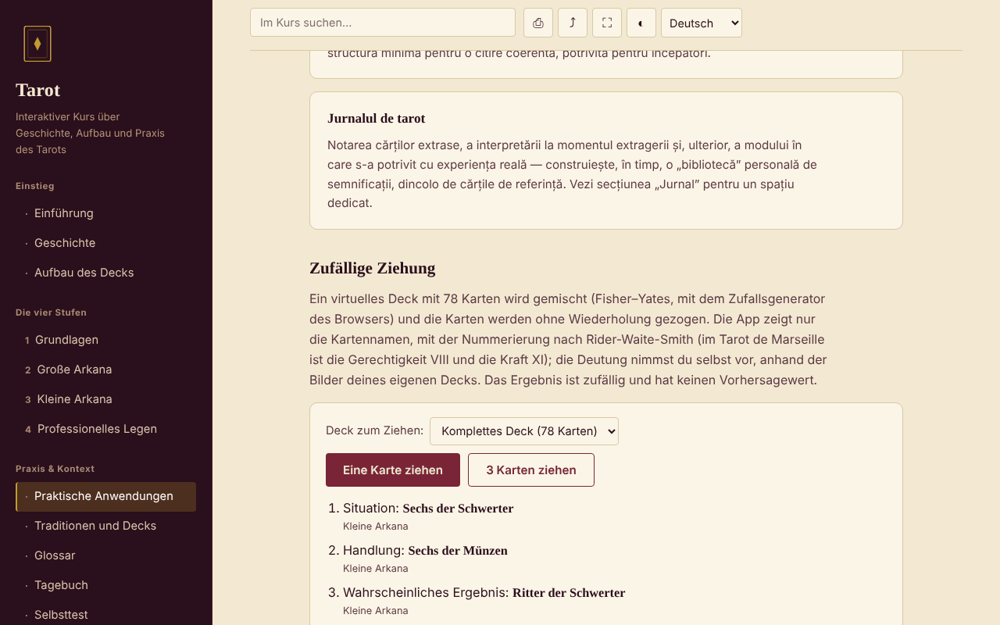

# Tarot — interaktiver Kurs

[English](README.md) · [Română](README.ro.md) · [Français](README.fr.md) · [Italiano](README.it.md) · [Español](README.es.md) · [Português](README.pt.md) · **Deutsch** · [Magyar](README.hu.md)

**Version:** 1.2.6 · **Zuletzt aktualisiert:** 2026-10-26

Oberflächensprachen: **Română, English, Français, Italiano, Español, Português (PT), Deutsch, Magyar**

Ein Kurs auf Rumänisch über Geschichte, Aufbau und Praxis des Tarots, in einer einzigen HTML-Datei, ohne Konto und ohne Server.

**Online-Anwendung:** https://chiuta.github.io/Tarot/

## Was es ist

Ein kleiner interaktiver Kurs über das Tarot als kulturelle und symbolische Tradition: Geschichte, Aufbau des 78-Karten-Decks, vier Kursstufen mit Übungen, ein Vergleich der Traditionen (Marseille, Rider-Waite-Smith, Thoth), Glossar, Tagebuch und Selbsttest. Das Tarot wird als Werkzeug der Reflexion und Unterhaltung behandelt, nicht als wissenschaftliche Methode.

## Funktionen

Abschnitte (Menü links, ☰ auf dem Handy): Einführung, Geschichte, Aufbau des Decks, die vier Stufen (Grundlagen, die Großen Arkana mit dem Diagramm der Reise des Narren, die Kleinen Arkana, Professionelles Legen), Praktische Anwendungen, Traditionen und Decks, Glossar, Tagebuch, Selbsttest.

Im Code und im Browser geprüft:
- Zufälliges Ziehen von 1 oder 3 Karten aus einem virtuellen Deck mit 78 Karten (Fisher–Yates-Mischen mit `crypto.getRandomValues`, ohne Wiederholungen); angezeigt werden nur die Kartennamen; das Ergebnis lässt sich ins Tagebuch übernehmen.
- Wahl des Decks für das Ziehen (vollständig 78 / nur Große Arkana 22 / nur Kleine Arkana 56); jede gezogene Karte zeigt auch ihre strukturelle Zugehörigkeit („Große Arkana“ / „Kleine Arkana“), ohne Deutungen.
- Suche im Kurs, unabhängig von diakritischen Zeichen; jedes Ergebnis zeigt einen Textausschnitt mit hervorgehobenem Begriff, und bei Auswahl scrollt die Seite zur Stelle und markiert sie.
- Direktlink zu einem Abschnitt (`#istoric`, `#quiz` usw.); die Zurück-/Vor-Tasten des Browsers funktionieren.
- Tagebuch als `.txt` herunterladbar und „Hochladen (.txt)“ (fügt den Text einer gewählten Datei bis 1 MB dem aktuellen Tagebuch hinzu; im Browser wird nichts gespeichert); Quiz mit 10 Fragen und gemischter Antwortreihenfolge.
- Drucken (nur der aktuelle Abschnitt), Link teilen/kopieren, Vollbild, Bildschirm aktiv halten (soweit der Browser sie unterstützt).

## Bedienungsanleitung

1. Wähle einen Abschnitt im Menü (auf dem Handy ☰ antippen).
2. Lies die Stufen der Reihe nach und probiere die praktischen Übungen aus.
3. Drücke unter „Praktische Anwendungen“ auf „Eine Karte ziehen“ oder „3 Karten ziehen“; die Deutung nimmst du selbst vor, mit deinem eigenen Deck.
4. Notiere im „Tagebuch“; drücke vor dem Schließen der Seite auf „Herunterladen (.txt)“ — das Tagebuch wird nicht gespeichert.
5. Beantworte im „Selbsttest“ die 10 Fragen; „Test wiederholen“ mischt die Antworten erneut.

## Datenschutz und Netzwerk

- Speicherung: Es werden weder `localStorage`, `sessionStorage`, IndexedDB noch Cookies verwendet. Das Tagebuch existiert nur auf der Seite; beim Schließen/Neuladen warnt der Browser, falls ungespeicherter Text vorhanden ist.
- Netzwerk: Es werden keine externen Anfragen gestellt (keine Schriftarten, Skripte, Bilder oder Analysedienste). Die Seite hat eine CSP-Richtlinie (`default-src 'none'`), die Verbindungen blockiert. Es gibt keine externen Links.
- Berechtigungen: Beim Laden wird nichts abgefragt. Beim Drücken von Schaltflächen können verwendet werden: Vollbild, Wake Lock (Bildschirm aktiv halten), Zwischenablage (Link kopieren) und Vibration auf dem Handy bei den Quizantworten.

## Grenzen und Hinweise

- Das Tarot ist eine kulturelle Tradition und ein Werkzeug der Reflexion/Unterhaltung. Es gibt keine wissenschaftlichen Belege dafür, dass es die Zukunft vorhersagen, diagnostizieren oder heilen kann.
- Der Inhalt ist lehrreich und ersetzt nicht den Rat einer Ärztin bzw. eines Arztes, von Psychologen, Juristen oder Finanzberatern. Brich keine Behandlung ab und triff keine wichtigen Entscheidungen auf Grundlage einer Ziehung.
- Historische Aussagen werden knapp dargestellt; die Zeilen zu Zertifizierungen und Kursen in Rumänien sind als ungeprüft gekennzeichnet.
- Es enthält keine Kartenbilder; beim Ziehen werden nur Namen angezeigt.

## Verlauf / Changelog

### 1.2.4 — 2026-10-22

fff-kit 1.1.4: Touch-Ziele und Mindestschriftgröße; Touch-Ziele und Text korrigiert.

- 1.2.3 — 2026-10-22: fff-kit 1.1.2: PBKDF2 mit 600.000 Iterationen, Schutz vor Clickjacking
- 1.2.2 — 2026-10-22: Die confirm()/prompt()-Fenster des Browsers durch eigene, in die 8 Sprachen übersetzte Dialoge ersetzt (Tagebuch leeren, manuelles Kopieren des Links).

- 1.1.0 — 2026-10-14: Datensicherung und Datenkennzeichnung (fff-kit).

- 1.0.0 — 2026-10-12: Die Version und das Datum der letzten Aktualisierung werden in der Anwendung angezeigt
- Die Suche zeigt jetzt den Ausschnitt, in dem der Begriff vorkommt (zuvor zeigten Suchanfragen wie „Der Turm“ nur den Abschnittstitel), und hebt den Treffer bei Auswahl im Text hervor.
- Hinzugefügt: Deckauswahl beim Ziehen, Kennzeichnung Große/Kleine Arkana, „Hochladen (.txt)“ im Tagebuch; CSP: `script-src` per SHA-256-Hash, ohne `'unsafe-inline'`; die Kartentitel in „Aufbau des Decks“ und „Praktische Anwendungen“ sind jetzt h3 (korrekte Überschriftenreihenfolge in diesen beiden Abschnitten; axe-core: 0 Verstöße in allen 12 Abschnitten, 1280 px).
- Die Seite hat jetzt eine Überschrift der Ebene 1 im Hauptbereich, sichtbar für Screenreader und auf dem Handy (dort ist das Seitenmenü ausgeblendet); das sichtbare Erscheinungsbild hat sich nicht geändert. axe-core: 0 Verstöße bei 1280 und 360 px.
- Der Inhalt bleibt ohne Kartenbilder und ohne Deutungen pro Karte (inhaltliche Entscheidung des Autors, unverändert).

## Lokal / offline ausführen

Lade `index.html` herunter und öffne die Datei im Browser; sie funktioniert ohne Internet.

## Lizenz

MIT — siehe Datei LICENSE.

## Autor

Alexio — Alexandru-Ionuț Chiuță, Kontakt: alexio@trom.tf

## Zusammenfassung

Ein Offline-Kurs in einer einzigen Datei, auf Rumänisch, über das Tarot als kulturelle und symbolische Tradition: Geschichte, Aufbau der 78 Karten, vier Kursstufen, Deckvergleich, Glossar, Tagebuch und ein Quiz mit 10 Fragen, dazu ein Werkzeug zum zufälligen Ziehen (Fisher–Yates mit `crypto.getRandomValues`). Keine Speicherung, keine externen Anfragen, keine Telemetrie. Das Tarot wird als Tradition und Unterhaltung dargestellt, ohne wissenschaftlichen Beleg für prognostische Kraft; es ersetzt keine medizinische, rechtliche oder finanzielle Beratung. Lizenz: MIT (siehe Datei LICENSE).
