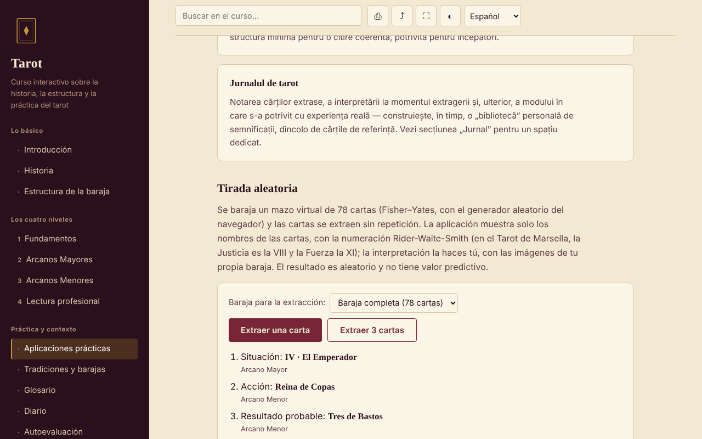

# Tarot — curso interactivo

[English](README.md) · [Română](README.ro.md) · [Français](README.fr.md) · [Italiano](README.it.md) · **Español** · [Português](README.pt.md) · [Deutsch](README.de.md) · [Magyar](README.hu.md)

**Versión:** 1.2.1 · **Última actualización:** 2026-10-19

Idiomas de la interfaz: **Română, English, Français, Italiano, Español, Português (PT), Deutsch, Magyar**

Curso en rumano sobre la historia, la estructura y la práctica del tarot, en un único archivo HTML, sin cuenta y sin servidor.

**Aplicación en línea:** https://chiuta.github.io/Tarot/

## Qué es

Un pequeño curso interactivo sobre el tarot como tradición cultural y simbólica: historia, estructura de la baraja de 78 cartas, cuatro niveles de curso con ejercicios, una comparación de tradiciones (Marsella, Rider-Waite-Smith, Thoth), glosario, diario y autoevaluación. El tarot se trata como herramienta de reflexión y entretenimiento, no como método científico.

## Funciones

Secciones (menú de la izquierda, ☰ en el móvil): Introducción, Historia, Estructura de la baraja, los cuatro niveles (Fundamentos, los Arcanos Mayores con el diagrama del Viaje del Loco, los Arcanos Menores, Lectura profesional), Aplicaciones prácticas, Tradiciones y barajas, Glosario, Diario, Autoevaluación.

Verificado en el código y en el navegador:
- Extracción aleatoria de 1 o 3 cartas de una baraja virtual de 78 (barajado Fisher–Yates con `crypto.getRandomValues`, sin repeticiones); solo se muestran los nombres de las cartas; el resultado se puede añadir al diario.
- Elección de la baraja para la extracción (completa 78 / solo Arcanos Mayores 22 / solo Arcanos Menores 56); cada carta extraída muestra también su pertenencia estructural («Arcano Mayor» / «Arcano Menor»), sin interpretaciones.
- Búsqueda en el curso, insensible a los signos diacríticos; cada resultado muestra un fragmento de texto con el término resaltado y, al seleccionarlo, la página se desplaza hasta ese lugar y lo marca.
- Enlace directo a una sección (`#istoric`, `#quiz`, etc.); los botones Atrás/Adelante del navegador funcionan.
- Diario descargable como `.txt` y «Cargar (.txt)» (añade el texto de un archivo elegido, de hasta 1 MB, al diario actual; no se guarda nada en el navegador); test de 10 preguntas con el orden de las respuestas mezclado.
- Impresión (solo la sección actual), compartir/copiar el enlace, pantalla completa, mantener la pantalla activa (donde el navegador lo admita).

## Manual de uso

1. Elige una sección en el menú (en el móvil, pulsa ☰).
2. Lee los niveles en orden y prueba los ejercicios prácticos.
3. En «Aplicaciones prácticas» pulsa «Extraer una carta» o «Extraer 3 cartas»; la interpretación la haces tú, con tu propia baraja.
4. Anota en el «Diario»; pulsa «Descargar (.txt)» antes de cerrar la página — el diario no se guarda.
5. En «Autoevaluación» responde a las 10 preguntas; «Repetir el test» vuelve a mezclar las respuestas.

## Privacidad y red

- Almacenamiento: no usa `localStorage`, `sessionStorage`, IndexedDB ni cookies. El diario existe solo en la página; al cerrar o recargar, el navegador te avisa si tienes texto sin guardar.
- Red: no hace ninguna solicitud externa (sin fuentes, scripts, imágenes ni analíticas). La página tiene una política CSP (`default-src 'none'`) que bloquea las conexiones. No hay enlaces externos.
- Permisos: no pide nada al cargar. Al pulsar los botones pueden usarse: pantalla completa, wake lock (pantalla activa), portapapeles (copia del enlace) y vibración en el móvil en las respuestas del test.

## Límites y advertencias

- El tarot es una tradición cultural y una herramienta de reflexión/entretenimiento. No hay pruebas científicas de que pueda predecir el futuro, diagnosticar o curar.
- El contenido es educativo y no sustituye el consejo de un médico, psicólogo, jurista o asesor financiero. No abandones un tratamiento ni tomes decisiones importantes basándote en una extracción.
- Las afirmaciones históricas se presentan de forma breve; las líneas sobre certificaciones y cursos en Rumanía están marcadas como no verificadas.
- No incluye las imágenes de las cartas; la extracción solo muestra nombres.

## Historial / Changelog

- 1.1.0 — 2026-10-14: Copia de seguridad y etiquetado de datos (fff-kit).

- 1.0.0 — 2026-10-12: la versión y la fecha de la última actualización se muestran en la aplicación
- La búsqueda muestra ahora el fragmento en el que aparece el término (antes, consultas como «La Torre» mostraban solo el título de la sección) y resalta la coincidencia en el texto al seleccionarla.
- Añadido: elección de la baraja para la extracción, etiqueta Arcano Mayor/Menor, «Cargar (.txt)» en el diario; CSP: `script-src` mediante hash SHA-256, sin `'unsafe-inline'`; los títulos de las tarjetas de «Estructura de la baraja» y «Aplicaciones prácticas» son ahora h3 (orden correcto de los títulos en estas dos secciones; axe-core: 0 infracciones en las 12 secciones, 1280 px).
- La página tiene ahora un título de nivel 1 en el área principal, visible para los lectores de pantalla y en el móvil (el menú lateral está oculto allí); el aspecto visible no ha cambiado. axe-core: 0 infracciones a 1280 y 360 px.
- El contenido sigue sin imágenes de las cartas y sin interpretaciones por carta (decisión de contenido del autor, sin cambios).

## Ejecución local / sin conexión

Descarga `index.html` y ábrelo en el navegador; funciona sin internet.

## Licencia

MIT — consulta el archivo LICENSE.

## Autor

Alexio — Alexandru-Ionuț Chiuță, contacto: alexio@trom.tf

## Resumen

Un curso de un solo archivo, sin conexión, en rumano, sobre el tarot como tradición cultural y simbólica: historia, estructura de las 78 cartas, cuatro niveles de curso, comparación de barajas, glosario, diario y un cuestionario de 10 preguntas, además de una herramienta de extracción aleatoria (Fisher–Yates con `crypto.getRandomValues`). Sin almacenamiento, sin solicitudes externas, sin telemetría. El tarot se presenta como tradición y entretenimiento, sin pruebas científicas de capacidad predictiva; no sustituye el consejo médico, jurídico ni financiero. Licencia: MIT (consulta el archivo LICENSE).
