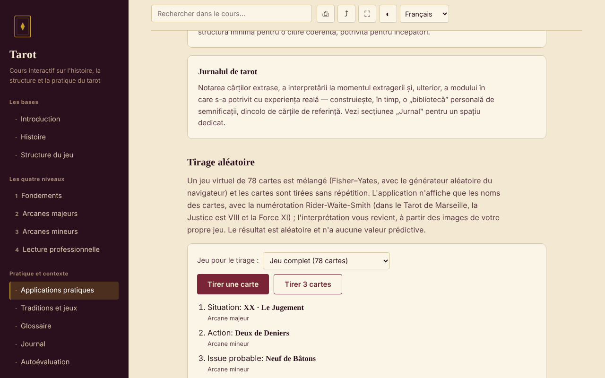

# Tarot — cours interactif

[English](README.md) · [Română](README.ro.md) · **Français** · [Italiano](README.it.md) · [Español](README.es.md) · [Português](README.pt.md) · [Deutsch](README.de.md) · [Magyar](README.hu.md)

**Version :** 2.0.1 · **Dernière mise à jour :** 2026-10-27

**Statut :** stable · **Hors ligne :** complet (aucune requête réseau)

Langues de l'interface : **Română, English, Français, Italiano, Español, Português (PT), Deutsch, Magyar**

Cours en roumain sur l'histoire, la structure et la pratique du tarot, dans un seul fichier HTML, sans compte et sans serveur.

**Application en ligne :** https://chiuta.github.io/Tarot/

## De quoi s'agit-il

Un petit cours interactif sur le tarot comme tradition culturelle et symbolique : histoire, structure du jeu de 78 cartes, quatre niveaux de cours avec exercices, comparaison des traditions (Marseille, Rider-Waite-Smith, Thoth), glossaire, journal et autoévaluation. Le tarot est traité comme un outil de réflexion et de divertissement, et non comme une méthode scientifique.

## Fonctionnalités

Sections (menu de gauche, ☰ sur mobile) : Introduction, Histoire, Structure du jeu, les quatre niveaux (Fondements, les Arcanes majeurs avec le diagramme du Voyage du Mat, les Arcanes mineurs, Lecture professionnelle), Applications pratiques, Traditions et jeux, Glossaire, Journal, Autoévaluation.

Vérifié dans le code et dans le navigateur :
- Tirage aléatoire de 1 ou 3 cartes dans un jeu virtuel de 78 cartes (mélange de Fisher–Yates avec `crypto.getRandomValues`, sans répétitions) ; seuls les noms des cartes sont affichés ; le résultat peut être ajouté au journal.
- Choix du jeu pour le tirage (complet 78 / Arcanes majeurs seulement 22 / Arcanes mineurs seulement 56) ; chaque carte tirée indique aussi son appartenance structurelle (« Arcane majeur » / « Arcane mineur »), sans interprétations.
- Recherche dans le cours, insensible aux diacritiques ; chaque résultat affiche un extrait de texte avec le terme mis en évidence, et, à la sélection, la page défile jusqu'à l'endroit et le marque.
- Lien direct vers une section (`#istoric`, `#quiz`, etc.) ; les boutons Précédent/Suivant du navigateur fonctionnent.
- Journal téléchargeable en `.txt` et « Charger (.txt) » (ajoute le texte d'un fichier choisi, jusqu'à 1 Mo, au journal en cours ; rien n'est enregistré dans le navigateur) ; test de 10 questions avec ordre des réponses mélangé.
- Impression (section courante uniquement), partage/copie du lien, plein écran, maintien de l'écran allumé (lorsque le navigateur les prend en charge).

## Mode d'emploi

1. Choisissez une section dans le menu (sur mobile, appuyez sur ☰).
2. Lisez les niveaux dans l'ordre et essayez les exercices pratiques.
3. Dans « Applications pratiques », appuyez sur « Tirer une carte » ou « Tirer 3 cartes » ; l'interprétation est de votre ressort, avec votre propre jeu.
4. Prenez des notes dans le « Journal » ; appuyez sur « Télécharger (.txt) » avant de fermer la page — le journal n'est pas enregistré.
5. Dans « Autoévaluation », répondez aux 10 questions ; « Refaire le test » mélange à nouveau les réponses.

## Confidentialité et réseau

- Stockage : n'utilise ni `localStorage`, ni `sessionStorage`, ni IndexedDB, ni cookies. Le journal n'existe que dans la page ; à la fermeture/au rechargement, le navigateur vous avertit si du texte n'est pas enregistré.
- Réseau : ne fait aucune requête externe (ni polices, ni scripts, ni images, ni outils d'analyse). La page a une politique CSP (`default-src 'none'`) qui bloque les connexions. Il n'y a aucun lien externe.
- Permissions : ne demande rien au chargement. Lorsque vous appuyez sur les boutons, peuvent être utilisés : le plein écran, le wake lock (écran maintenu allumé), le presse-papiers (copie du lien) et la vibration sur mobile pour les réponses du test.

## Limites et avertissements

- Le tarot est une tradition culturelle et un outil de réflexion/divertissement. Il n'existe aucune preuve scientifique qu'il puisse prédire l'avenir, diagnostiquer ou guérir.
- Le contenu est éducatif et ne remplace pas l'avis d'un médecin, d'un psychologue, d'un juriste ou d'un conseiller financier. N'abandonnez pas un traitement et ne prenez pas de décisions importantes sur la base d'un tirage.
- Les affirmations historiques sont présentées brièvement ; les lignes concernant les certifications et les cours en Roumanie sont signalées comme non vérifiées.
- Il n'inclut pas les images des cartes ; le tirage n'affiche que des noms.

## Historique / Changelog

### 1.2.4 — 2026-10-22

fff-kit 1.1.4 : cibles tactiles et taille de texte minimale; cibles tactiles et texte corrigés.

- 1.2.3 — 2026-10-22 : fff-kit 1.1.2 : PBKDF2 à 600 000 itérations, protection anti-clickjacking
- 1.2.2 — 2026-10-22: Les boîtes confirm()/prompt() du navigateur remplacées par des dialogues propres, traduits dans les 8 langues (vidage du journal, copie manuelle du lien).

- 1.1.0 — 2026-10-14 : Sauvegarde et étiquetage des données (fff-kit).

- 1.0.0 — 2026-10-12 : la version et la date de dernière mise à jour sont affichées dans l'application
- La recherche affiche désormais l'extrait où apparaît le terme (auparavant, des requêtes comme « La Tour » n'affichaient que le titre de la section) et met en évidence la correspondance dans le texte à la sélection.
- Ajouté : choix du jeu pour le tirage, étiquette Arcane majeur/mineur, « Charger (.txt) » dans le journal ; CSP : `script-src` par hachage SHA-256, sans `'unsafe-inline'` ; les titres des cartes de « Structure du jeu » et « Applications pratiques » sont maintenant des h3 (ordre correct des titres dans ces deux sections ; axe-core : 0 violation sur les 12 sections, 1280 px).
- La page a désormais un titre de niveau 1 dans la zone principale, visible des lecteurs d'écran et sur mobile (le menu latéral y est masqué) ; l'apparence visible n'a pas changé. axe-core : 0 violation à 1280 et 360 px.
- Le contenu reste sans images de cartes et sans interprétations par carte (choix de contenu de l'auteur, inchangé).

## Exécution en local / hors ligne

Téléchargez `index.html` et ouvrez-le dans le navigateur ; il fonctionne sans internet.

## Licence

MIT — voir le fichier LICENSE.

## Auteur

Alexio — Alexandru-Ionuț Chiuță, contact : alexio@trom.tf

## Résumé

Un cours monofichier, hors ligne, en roumain, sur le tarot comme tradition culturelle et symbolique : histoire, structure des 78 cartes, quatre niveaux de cours, comparaison des jeux, glossaire, journal et quiz de 10 questions, ainsi qu'un outil de tirage aléatoire (Fisher–Yates avec `crypto.getRandomValues`). Aucun stockage, aucune requête externe, aucune télémétrie. Le tarot est présenté comme tradition et divertissement, sans preuve scientifique d'un pouvoir prédictif ; il ne remplace pas un avis médical, juridique ou financier. Licence : MIT (voir le fichier LICENSE).
