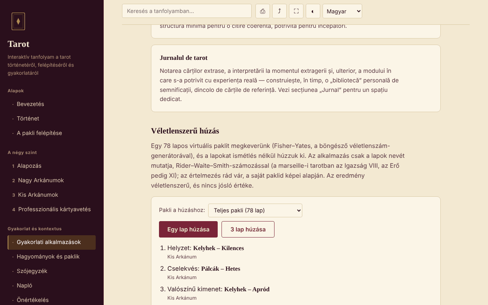

# Tarot — interaktív tanfolyam

[English](README.md) · [Română](README.ro.md) · [Français](README.fr.md) · [Italiano](README.it.md) · [Español](README.es.md) · [Português](README.pt.md) · [Deutsch](README.de.md) · **Magyar**

**Verzió:** 1.2.5 · **Utolsó frissítés:** 2026-10-23

A felület nyelvei: **Română, English, Français, Italiano, Español, Português (PT), Deutsch, Magyar**

Román nyelvű tanfolyam a tarot történetéről, felépítéséről és gyakorlatáról, egyetlen HTML-fájlban, fiók és szerver nélkül.

**Online alkalmazás:** https://chiuta.github.io/Tarot/

## Mi ez

Egy kis interaktív tanfolyam a tarotról mint kulturális és szimbolikus hagyományról: történet, a 78 lapos pakli felépítése, négy tanfolyami szint gyakorlatokkal, a hagyományok összehasonlítása (Marseille, Rider-Waite-Smith, Thoth), szószedet, napló és önértékelés. A tarotot az elmélkedés és a szórakozás eszközeként kezeli, nem tudományos módszerként.

## Funkciók

Szakaszok (bal oldali menü, mobilon ☰): Bevezetés, Történet, A pakli felépítése, a négy szint (Alapok, a Nagy Arkánumok a Bolond útja diagrammal, a Kis Arkánumok, Professzionális kirakás), Gyakorlati alkalmazások, Hagyományok és paklik, Szószedet, Napló, Önértékelés.

A kódban és a böngészőben ellenőrizve:
- 1 vagy 3 lap véletlenszerű húzása egy 78 lapos virtuális pakliból (Fisher–Yates keverés `crypto.getRandomValues` használatával, ismétlődés nélkül); csak a lapok nevei jelennek meg; az eredmény hozzáadható a naplóhoz.
- A húzáshoz használt pakli kiválasztása (teljes 78 / csak Nagy Arkánumok, 22 / csak Kis Arkánumok, 56); minden kihúzott lap a szerkezeti hovatartozását is mutatja („Nagy Arkánum” / „Kis Arkánum”), értelmezések nélkül.
- Keresés a tanfolyamban, ékezetfüggetlenül; minden találat szövegrészletet mutat a kiemelt kifejezéssel, kiválasztáskor pedig az oldal odagörget, és megjelöli a helyet.
- Közvetlen hivatkozás egy szakaszra (`#istoric`, `#quiz` stb.); a böngésző Vissza/Előre gombjai működnek.
- A napló letölthető `.txt` fájlként, valamint „Feltöltés (.txt)” (a kiválasztott fájl szövegét, legfeljebb 1 MB-ot, hozzáfűzi az aktuális naplóhoz; semmi sem mentődik a böngészőbe); 10 kérdéses teszt kevert válaszsorrenddel.
- Nyomtatás (csak az aktuális szakasz), hivatkozás megosztása/másolása, teljes képernyő, a képernyő ébren tartása (ahol a böngésző támogatja).

## Használati útmutató

1. Válassz egy szakaszt a menüből (mobilon koppints a ☰ jelre).
2. Olvasd el a szinteket sorrendben, és próbáld ki a gyakorlati feladatokat.
3. A „Gyakorlati alkalmazások” részben nyomd meg a „Egy lap húzása” vagy a „3 lap húzása” gombot; az értelmezést te végzed el, a saját paklid segítségével.
4. Jegyezz a „Naplóba”; az oldal bezárása előtt nyomd meg a „Letöltés (.txt)” gombot — a napló nem mentődik.
5. Az „Önértékelésben” válaszolj a 10 kérdésre; a „Teszt újraindítása” újra összekeveri a válaszokat.

## Adatvédelem és hálózat

- Tárolás: nem használ `localStorage`-ot, `sessionStorage`-ot, IndexedDB-t vagy sütiket. A napló csak az oldalon létezik; bezáráskor/újratöltéskor a böngésző figyelmeztet, ha mentetlen szöveg van.
- Hálózat: nem küld külső kéréseket (nincs betűtípus, szkript, kép vagy analitika). Az oldalon CSP-szabály van érvényben (`default-src 'none'`), amely blokkolja a kapcsolatokat. Nincsenek külső hivatkozások.
- Engedélyek: betöltéskor semmit sem kér. A gombok megnyomásakor használható: teljes képernyő, wake lock (ébren tartott képernyő), vágólap (hivatkozás másolása) és mobilon rezgés a tesztválaszoknál.

## Korlátok és figyelmeztetések

- A tarot kulturális hagyomány, valamint az elmélkedés/szórakozás eszköze. Nincs tudományos bizonyíték arra, hogy képes lenne megjósolni a jövőt, diagnosztizálni vagy gyógyítani.
- A tartalom oktató jellegű, és nem helyettesíti orvos, pszichológus, jogász vagy pénzügyi tanácsadó véleményét. Ne hagyj abba kezelést, és ne hozz fontos döntéseket egy húzás alapján.
- A történeti állítások tömören szerepelnek; a romániai tanúsítványokról és tanfolyamokról szóló sorok ellenőrizetlenként vannak megjelölve.
- Nem tartalmaz lapképeket; a húzás csak neveket jelenít meg.

## Előzmények / Changelog

### 1.2.4 — 2026-10-22

fff-kit 1.1.4: érintési célok és minimális szövegméret; érintési célok és szöveg javítva.

- 1.2.3 — 2026-10-22: fff-kit 1.1.2: PBKDF2 600 000 iterációval, clickjacking elleni védelem
- 1.2.2 — 2026-10-22: A böngésző confirm()/prompt() ablakait saját, mind a 8 nyelvre lefordított párbeszédablakok váltják (a napló törlése, a hivatkozás kézi másolása).

- 1.1.0 — 2026-10-14: Biztonsági mentés és adatcímkézés (fff-kit).

- 1.0.0 — 2026-10-12: a verzió és az utolsó frissítés dátuma megjelenik az alkalmazásban
- A keresés most azt a részletet mutatja, amelyben a kifejezés előfordul (korábban az olyan keresések, mint „A Torony”, csak a szakasz címét mutatták), és kiválasztáskor kiemeli a találatot a szövegben.
- Hozzáadva: pakliválasztás a húzáshoz, Nagy/Kis Arkánum címke, „Feltöltés (.txt)” a naplóban; CSP: `script-src` SHA-256 hash alapján, `'unsafe-inline'` nélkül; a „A pakli felépítése” és a „Gyakorlati alkalmazások” kártyacímei most h3 elemek (helyes címsorrend ebben a két szakaszban; axe-core: 0 hiba mind a 12 szakaszon, 1280 px).
- Az oldalnak most van 1. szintű címsora a fő területen, amely a képernyőolvasók számára és mobilon is látható (ott az oldalmenü rejtett); a látható megjelenés nem változott. axe-core: 0 hiba 1280 és 360 px-en.
- A tartalom továbbra is lapképek és lapokra bontott értelmezések nélkül marad (a szerző tartalmi döntése, változatlan).

## Futtatás helyben / offline

Töltsd le az `index.html` fájlt, és nyisd meg a böngészőben; internet nélkül működik.

## Licenc

MIT — lásd a LICENSE fájlt.

## Szerző

Alexio — Alexandru-Ionuț Chiuță, kapcsolat: alexio@trom.tf

## Összefoglaló

Egyetlen fájlból álló, offline, román nyelvű tanfolyam a tarotról mint kulturális és szimbolikus hagyományról: történet, a 78 lap felépítése, négy tanfolyami szint, paklik összehasonlítása, szószedet, napló és 10 kérdéses kvíz, valamint véletlenszerű húzóeszköz (Fisher–Yates `crypto.getRandomValues`-szal). Nincs tárolás, nincsenek külső kérések, nincs telemetria. A tarot hagyományként és szórakozásként jelenik meg, jósló erejére nincs tudományos bizonyíték; nem helyettesíti az orvosi, jogi vagy pénzügyi tanácsadást. Licenc: MIT (lásd a LICENSE fájlt).
