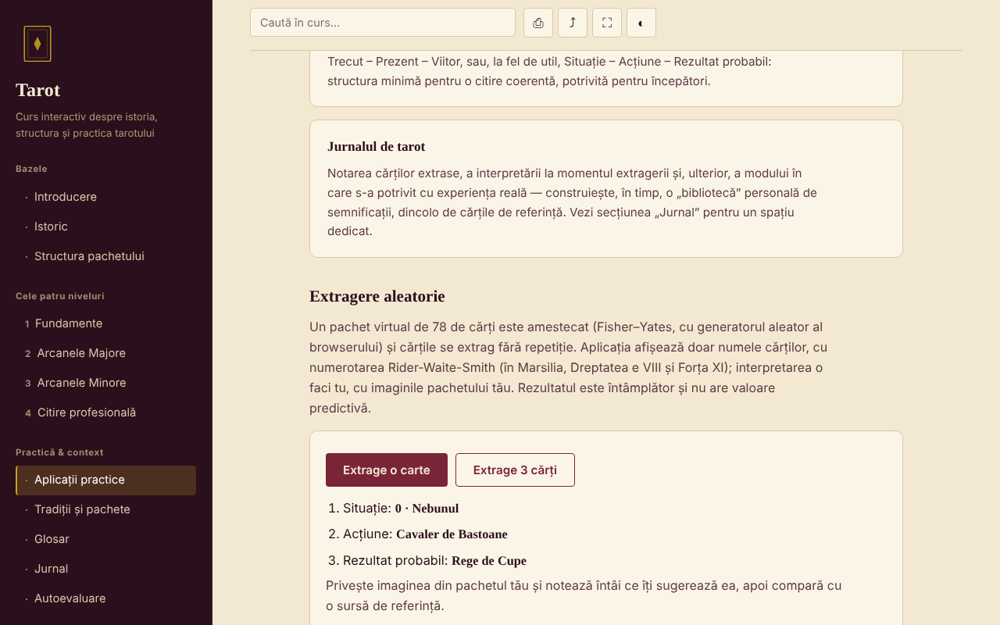

# Tarot — corso interattivo

[English](README.md) · [Română](README.ro.md) · [Français](README.fr.md) · **Italiano** · [Español](README.es.md) · [Português](README.pt.md) · [Deutsch](README.de.md) · [Magyar](README.hu.md)

**Versione:** 1.1.0 · **Ultimo aggiornamento:** 2026-10-14

Corso in rumeno sulla storia, la struttura e la pratica dei tarocchi, in un unico file HTML, senza account e senza server.

**Applicazione online:** https://chiuta.github.io/Tarot/

## Che cos'è

Un piccolo corso interattivo sui tarocchi come tradizione culturale e simbolica: storia, struttura del mazzo di 78 carte, quattro livelli di corso con esercizi, un confronto tra le tradizioni (Marsiglia, Rider-Waite-Smith, Thoth), glossario, diario e autovalutazione. I tarocchi sono trattati come strumento di riflessione e di intrattenimento, non come metodo scientifico.

## Funzionalità

Sezioni (menu a sinistra, ☰ su mobile): Introduzione, Storia, Struttura del mazzo, i quattro livelli (Fondamenti, gli Arcani Maggiori con il diagramma del Viaggio del Matto, gli Arcani Minori, Lettura professionale), Applicazioni pratiche, Tradizioni e mazzi, Glossario, Diario, Autovalutazione.

Verificato nel codice e nel browser:
- Estrazione casuale di 1 o 3 carte da un mazzo virtuale di 78 (mescolamento Fisher–Yates con `crypto.getRandomValues`, senza ripetizioni); vengono mostrati solo i nomi delle carte; il risultato può essere aggiunto al diario.
- Scelta del mazzo per l'estrazione (completo 78 / solo Arcani Maggiori 22 / solo Arcani Minori 56); ogni carta estratta mostra anche l'appartenenza strutturale («Arcano Maggiore» / «Arcano Minore»), senza interpretazioni.
- Ricerca nel corso, insensibile ai segni diacritici; ogni risultato mostra un frammento di testo con il termine evidenziato e, alla selezione, la pagina scorre fino al punto e lo segna.
- Link diretto a una sezione (`#istoric`, `#quiz` ecc.); i pulsanti Indietro/Avanti del browser funzionano.
- Diario scaricabile come `.txt` e «Carica (.txt)» (aggiunge il testo di un file scelto, fino a 1 MB, al diario corrente; nulla viene salvato nel browser); test di 10 domande con ordine delle risposte mescolato.
- Stampa (solo la sezione corrente), condivisione/copia del link, schermo intero, schermo sempre attivo (dove il browser li supporta).

## Guida all'uso

1. Scegli una sezione dal menu (su mobile tocca ☰).
2. Leggi i livelli in ordine e prova gli esercizi pratici.
3. In «Applicazioni pratiche» premi «Estrai una carta» o «Estrai 3 carte»; l'interpretazione la fai tu, con il tuo mazzo.
4. Annota nel «Diario»; premi «Scarica (.txt)» prima di chiudere la pagina — il diario non viene salvato.
5. In «Autovalutazione» rispondi alle 10 domande; «Ripeti il test» mescola di nuovo le risposte.

## Privacy e rete

- Archiviazione: non usa `localStorage`, `sessionStorage`, IndexedDB né cookie. Il diario esiste solo nella pagina; alla chiusura/ricarica il browser ti avvisa se hai testo non salvato.
- Rete: non effettua alcuna richiesta esterna (niente font, script, immagini o strumenti di analisi). La pagina ha una policy CSP (`default-src 'none'`) che blocca le connessioni. Non ci sono link esterni.
- Permessi: non chiede nulla al caricamento. Alla pressione dei pulsanti possono essere usati: schermo intero, wake lock (schermo attivo), appunti (copia del link) e vibrazione su mobile per le risposte del test.

## Limiti e avvertenze

- I tarocchi sono una tradizione culturale e uno strumento di riflessione/intrattenimento. Non esistono prove scientifiche che possano predire il futuro, diagnosticare o guarire.
- Il contenuto è didattico e non sostituisce il parere di un medico, di uno psicologo, di un giurista o di un consulente finanziario. Non abbandonare una terapia e non prendere decisioni importanti sulla base di un'estrazione.
- Le affermazioni storiche sono presentate in breve; le righe su certificazioni e corsi in Romania sono segnalate come non verificate.
- Non include le immagini delle carte; l'estrazione mostra solo i nomi.

## Cronologia / Changelog

- 1.1.0 — 2026-10-14: Copia di riserva ed etichettatura dei dati (fff-kit).

- 1.0.0 — 2026-10-12: la versione e la data dell'ultimo aggiornamento sono mostrate nell'applicazione
- La ricerca ora mostra il frammento in cui compare il termine (prima, query come «La Torre» mostravano solo il titolo della sezione) ed evidenzia la corrispondenza nel testo alla selezione.
- Aggiunto: scelta del mazzo per l'estrazione, etichetta Arcano Maggiore/Minore, «Carica (.txt)» nel diario; CSP: `script-src` tramite hash SHA-256, senza `'unsafe-inline'`; i titoli delle schede in «Struttura del mazzo» e «Applicazioni pratiche» sono ora h3 (ordine corretto dei titoli in queste due sezioni; axe-core: 0 violazioni su tutte le 12 sezioni, 1280 px).
- La pagina ha ora un titolo di livello 1 nell'area principale, visibile agli screen reader e su mobile (il menu laterale lì è nascosto); l'aspetto visibile non è cambiato. axe-core: 0 violazioni a 1280 e 360 px.
- Il contenuto resta senza immagini delle carte e senza interpretazioni per singola carta (scelta di contenuto dell'autore, invariata).

## Esecuzione in locale / offline

Scarica `index.html` e aprilo nel browser; funziona senza internet.

## Licenza

MIT — vedi il file LICENSE.

## Autore

Alexio — Alexandru-Ionuț Chiuță, contatto: alexio@trom.tf

## Riepilogo

Un corso in un unico file, offline, in rumeno, sui tarocchi come tradizione culturale e simbolica: storia, struttura delle 78 carte, quattro livelli di corso, confronto tra mazzi, glossario, diario e quiz di 10 domande, più uno strumento di estrazione casuale (Fisher–Yates con `crypto.getRandomValues`). Nessuna archiviazione, nessuna richiesta esterna, nessuna telemetria. I tarocchi sono presentati come tradizione e intrattenimento, senza prove scientifiche di capacità predittiva; non sostituiscono un parere medico, legale o finanziario. Licenza: MIT (vedi il file LICENSE).
