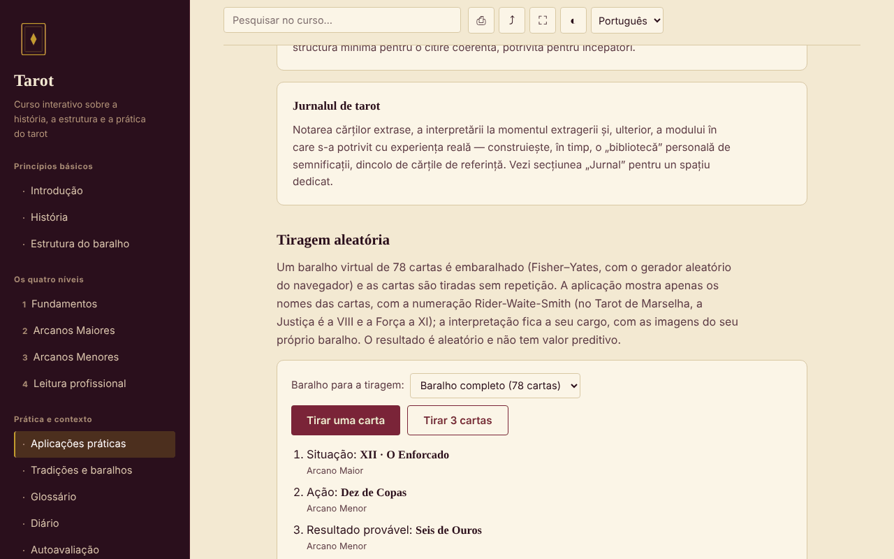

# Tarot — curso interativo

[English](README.md) · [Română](README.ro.md) · [Français](README.fr.md) · [Italiano](README.it.md) · [Español](README.es.md) · **Português** · [Deutsch](README.de.md) · [Magyar](README.hu.md)

**Versão:** 2.0.1 · **Última atualização:** 2026-10-27

**Estado:** estável · **Offline:** completo (sem pedidos de rede)

Idiomas da interface: **Română, English, Français, Italiano, Español, Português (PT), Deutsch, Magyar**

Curso em romeno sobre a história, a estrutura e a prática do tarot, num único ficheiro HTML, sem conta e sem servidor.

**Aplicação online:** https://chiuta.github.io/Tarot/

## O que é

Um pequeno curso interativo sobre o tarot como tradição cultural e simbólica: história, estrutura do baralho de 78 cartas, quatro níveis de curso com exercícios, uma comparação das tradições (Marselha, Rider-Waite-Smith, Thoth), glossário, diário e autoavaliação. O tarot é tratado como instrumento de reflexão e de entretenimento, não como método científico.

## Funcionalidades

Secções (menu da esquerda, ☰ no telemóvel): Introdução, História, Estrutura do baralho, os quatro níveis (Fundamentos, os Arcanos Maiores com o diagrama da Viagem do Louco, os Arcanos Menores, Leitura profissional), Aplicações práticas, Tradições e baralhos, Glossário, Diário, Autoavaliação.

Verificado no código e no navegador:
- Extração aleatória de 1 ou 3 cartas de um baralho virtual de 78 (baralhamento Fisher–Yates com `crypto.getRandomValues`, sem repetições); apenas os nomes das cartas são apresentados; o resultado pode ser adicionado ao diário.
- Escolha do baralho para a extração (completo 78 / apenas Arcanos Maiores 22 / apenas Arcanos Menores 56); cada carta extraída mostra também a pertença estrutural («Arcano Maior» / «Arcano Menor»), sem interpretações.
- Pesquisa no curso, insensível aos sinais diacríticos; cada resultado mostra um excerto de texto com o termo realçado e, ao selecionar, a página desloca-se até esse local e assinala-o.
- Ligação direta a uma secção (`#istoric`, `#quiz`, etc.); os botões Recuar/Avançar do navegador funcionam.
- Diário descarregável como `.txt` e «Carregar (.txt)» (acrescenta o texto de um ficheiro escolhido, até 1 MB, ao diário atual; nada é guardado no navegador); teste de 10 perguntas com a ordem das respostas misturada.
- Impressão (apenas a secção atual), partilha/cópia da ligação, ecrã inteiro, manter o ecrã ativo (onde o navegador o permita).

## Manual de utilização

1. Escolha uma secção no menu (no telemóvel, toque em ☰).
2. Leia os níveis por ordem e experimente os exercícios práticos.
3. Em «Aplicações práticas» prima «Extrair uma carta» ou «Extrair 3 cartas»; a interpretação é consigo, com o seu próprio baralho.
4. Tome notas no «Diário»; prima «Descarregar (.txt)» antes de fechar a página — o diário não é guardado.
5. Em «Autoavaliação» responda às 10 perguntas; «Repetir o teste» volta a misturar as respostas.

## Privacidade e rede

- Armazenamento: não utiliza `localStorage`, `sessionStorage`, IndexedDB nem cookies. O diário existe apenas na página; ao fechar/recarregar, o navegador avisa-o se tiver texto por guardar.
- Rede: não faz qualquer pedido externo (sem tipos de letra, scripts, imagens nem ferramentas de análise). A página tem uma política CSP (`default-src 'none'`) que bloqueia as ligações. Não existem ligações externas.
- Permissões: não pede nada ao carregar. Ao premir os botões, podem ser utilizados: ecrã inteiro, wake lock (ecrã ativo), área de transferência (cópia da ligação) e vibração no telemóvel nas respostas do teste.

## Limites e avisos

- O tarot é uma tradição cultural e um instrumento de reflexão/entretenimento. Não existem provas científicas de que possa prever o futuro, diagnosticar ou curar.
- O conteúdo é educativo e não substitui o conselho de um médico, psicólogo, jurista ou consultor financeiro. Não abandone um tratamento nem tome decisões importantes com base numa extração.
- As afirmações históricas são apresentadas de forma resumida; as linhas sobre certificações e cursos na Roménia estão assinaladas como não verificadas.
- Não inclui as imagens das cartas; a extração mostra apenas nomes.

## Histórico / Changelog

### 1.2.4 — 2026-10-22

fff-kit 1.1.4: alvos de toque e tamanho mínimo do texto; alvos de toque e texto corrigidos.

- 1.2.3 — 2026-10-22: fff-kit 1.1.2: PBKDF2 com 600.000 iterações, proteção anti-clickjacking
- 1.2.2 — 2026-10-22: As caixas confirm()/prompt() do navegador substituídas por diálogos próprios traduzidos nos 8 idiomas (limpar o diário, cópia manual da ligação).

- 1.1.0 — 2026-10-14: Cópia de segurança e etiquetagem de dados (fff-kit).

- 1.0.0 — 2026-10-12: a versão e a data da última atualização são apresentadas na aplicação
- A pesquisa mostra agora o excerto em que o termo aparece (antes, pesquisas como «A Torre» mostravam apenas o título da secção) e realça a correspondência no texto ao selecionar.
- Adicionado: escolha do baralho para a extração, etiqueta Arcano Maior/Menor, «Carregar (.txt)» no diário; CSP: `script-src` por hash SHA-256, sem `'unsafe-inline'`; os títulos dos cartões de «Estrutura do baralho» e «Aplicações práticas» são agora h3 (ordem correta dos títulos nestas duas secções; axe-core: 0 violações em todas as 12 secções, 1280 px).
- A página tem agora um título de nível 1 na área principal, visível para os leitores de ecrã e no telemóvel (o menu lateral está oculto aí); o aspeto visível não mudou. axe-core: 0 violações a 1280 e 360 px.
- O conteúdo continua sem imagens das cartas e sem interpretações por carta (opção de conteúdo do autor, inalterada).

## Execução local / offline

Descarregue `index.html` e abra-o no navegador; funciona sem internet.

## Licença

MIT — veja o ficheiro LICENSE.

## Autor

Alexio — Alexandru-Ionuț Chiuță, contacto: alexio@trom.tf

## Resumo

Um curso de ficheiro único, offline, em romeno, sobre o tarot como tradição cultural e simbólica: história, estrutura das 78 cartas, quatro níveis de curso, comparação de baralhos, glossário, diário e questionário de 10 perguntas, além de uma ferramenta de extração aleatória (Fisher–Yates com `crypto.getRandomValues`). Sem armazenamento, sem pedidos externos, sem telemetria. O tarot é apresentado como tradição e entretenimento, sem provas científicas de capacidade preditiva; não substitui aconselhamento médico, jurídico ou financeiro. Licença: MIT (veja o ficheiro LICENSE).
