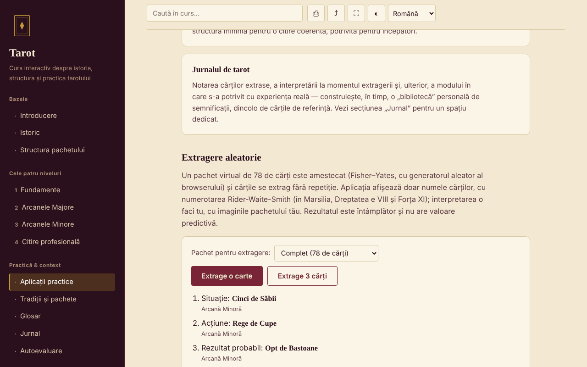

# Tarot — curs interactiv

[English](README.md) · **Română** · [Français](README.fr.md) · [Italiano](README.it.md) · [Español](README.es.md) · [Português](README.pt.md) · [Deutsch](README.de.md) · [Magyar](README.hu.md)

**Versiune:** 1.2.6 · **Ultima actualizare:** 2026-10-26

Limbile interfeței: **Română, English, Français, Italiano, Español, Português (PT), Deutsch, Magyar**

Curs în română despre istoria, structura și practica tarotului, într-un singur fișier HTML, fără cont și fără server.

**Live:** https://chiuta.github.io/Tarot/

## Ce este

Un mic curs interactiv despre tarot ca tradiție culturală și simbolică: istoric, structura pachetului de 78 de cărți, patru niveluri de curs cu exerciții, o comparație a tradițiilor (Marsilia, Rider-Waite-Smith, Thoth), glosar, jurnal și autoevaluare. Tarotul este tratat ca instrument de reflecție și divertisment, nu ca metodă științifică.

## Funcții

Secțiuni (meniul din stânga, ☰ pe mobil): Introducere, Istoric, Structura pachetului, cele patru niveluri (Fundamente, Arcanele Majore cu diagrama Călătoriei Nebunului, Arcanele Minore, Citire profesională), Aplicații practice, Tradiții și pachete, Glosar, Jurnal, Autoevaluare.

Verificate în cod și în browser:
- Extragere aleatorie de 1 sau 3 cărți dintr-un pachet virtual de 78 (amestecare Fisher–Yates cu `crypto.getRandomValues`, fără repetiții); se afișează doar numele cărților; rezultatul se poate adăuga în jurnal.
- Alegerea pachetului pentru extragere (complet 78 / doar Arcanele Majore 22 / doar Arcanele Minore 56); fiecare carte extrasă arată și apartenența structurală („Arcană Majoră” / „Arcană Minoră”), fără interpretări.
- Căutare în curs, fără sensibilitate la diacritice; fiecare rezultat arată un fragment de text cu termenul evidențiat, iar la alegere pagina derulează la locul respectiv și îl marchează.
- Link direct la o secțiune (`#istoric`, `#quiz` etc.), butoanele Înapoi/Înainte ale browserului funcționează.
- Jurnal descărcabil ca `.txt` și „Încarcă (.txt)” (adaugă textul unui fișier ales, până la 1 MB, la jurnalul curent; nu se salvează nimic în browser); test de 10 întrebări cu ordinea răspunsurilor amestecată.
- Printare (doar secțiunea curentă), distribuire/copiere link, ecran complet, păstrare ecran activ (unde browserul le acceptă).

## Manual de utilizare

1. Alege o secțiune din meniu (pe mobil apasă ☰).
2. Citește nivelurile în ordine și încearcă exercițiile practice.
3. În „Aplicații practice” apasă „Extrage o carte” sau „Extrage 3 cărți”; interpretarea o faci tu, cu pachetul tău.
4. Notează în „Jurnal”; apasă „Descarcă (.txt)” înainte să închizi pagina — jurnalul nu se salvează.
5. În „Autoevaluare” răspunde la cele 10 întrebări; „Reia testul” amestecă din nou răspunsurile.

## Confidențialitate și rețea

- Stocare: nu folosește `localStorage`, `sessionStorage`, IndexedDB sau cookie-uri. Jurnalul există doar în pagină; la închidere/reîncărcare browserul te avertizează dacă ai text nesalvat.
- Rețea: nu face nicio cerere externă (fără fonturi, scripturi, imagini sau analitice). Pagina are o politică CSP (`default-src 'none'`) care blochează conexiunile. Nu există linkuri externe.
- Permisiuni: nu cere nimic la încărcare. La apăsarea butoanelor pot fi folosite: ecran complet, wake lock (ecran activ), clipboard (copiere link) și vibrații pe mobil la răspunsurile din test.

## Limite și avertismente

- Tarotul este o tradiție culturală și un instrument de reflecție/divertisment. Nu există dovezi științifice că poate prezice viitorul, diagnostica sau vindeca.
- Conținutul este educațional și nu înlocuiește sfatul unui medic, psiholog, jurist sau consilier financiar. Nu renunța la un tratament și nu lua decizii importante pe baza unei extrageri.
- Afirmațiile istorice sunt prezentate pe scurt; rândurile despre certificări și cursuri din România sunt marcate ca neverificate.
- Nu include imaginile cărților; extragerea afișează doar nume.

## Istoric / Changelog

### 1.2.4 — 2026-10-22

fff-kit 1.1.4: ținte tactile și text minim; ținte tactile/text corectate.

- 1.2.3 — 2026-10-22: fff-kit 1.1.2: PBKDF2 600 000 iterații, protecție anti-clickjacking
- 1.2.2 — 2026-10-22: Casetele confirm()/prompt() ale browserului înlocuite cu dialoguri proprii, traduse în cele 8 limbi (golirea jurnalului, copierea manuală a linkului).

- 1.1.0 — 2026-10-14: Copie de rezervă și etichetare date (fff-kit).

- 1.0.0 — 2026-10-12: versiunea și data ultimei actualizări sunt afișate în aplicație
- Căutarea afișează acum fragmentul în care apare termenul (înainte, interogări precum „Turnul” arătau doar titlul secțiunii) și evidențiază potrivirea în text la selectare.
- Adăugat: alegerea pachetului la extragere, eticheta Arcană Majoră/Minoră, „Încarcă (.txt)” în jurnal; CSP: `script-src` pe hash SHA-256, fără `'unsafe-inline'`; titlurile cardurilor din „Structura pachetului” și „Aplicații practice” sunt acum h3 (ordine corectă a titlurilor în aceste două secțiuni; axe-core: 0 violări pe toate cele 12 secțiuni, 1280 px).
- Pagina are acum un titlu de nivel 1 în zona principală, vizibil cititoarelor de ecran și pe mobil (meniul lateral este ascuns acolo); aspectul vizibil nu s-a schimbat. axe-core: 0 violări la 1280 și 360 px.
- Conținutul rămâne fără imagini ale cărților și fără interpretări per carte (alegere de conținut a autorului, neschimbată).

## Rulare locală / offline

Descarcă `index.html` și deschide-l în browser; funcționează fără internet.

## Licență

MIT — vezi fișierul LICENSE.

## Autor

Alexio — Alexandru-Ionuț Chiuță, contact: alexio@trom.tf

## Rezumat

Un curs offline într-un singur fișier, în limba română, despre tarot ca tradiție culturală și simbolică: istorie, structura de 78 de cărți, patru niveluri de curs, comparație de pachete, glosar, jurnal și un test de 10 întrebări, plus un instrument de extragere aleatorie (Fisher–Yates cu `crypto.getRandomValues`). Fără stocare, fără cereri externe, fără telemetrie. Tarotul este prezentat ca tradiție și divertisment, fără dovezi științifice ale puterii predictive; nu înlocuiește sfatul medical, juridic sau financiar. Licență: MIT (vezi fișierul LICENSE).
